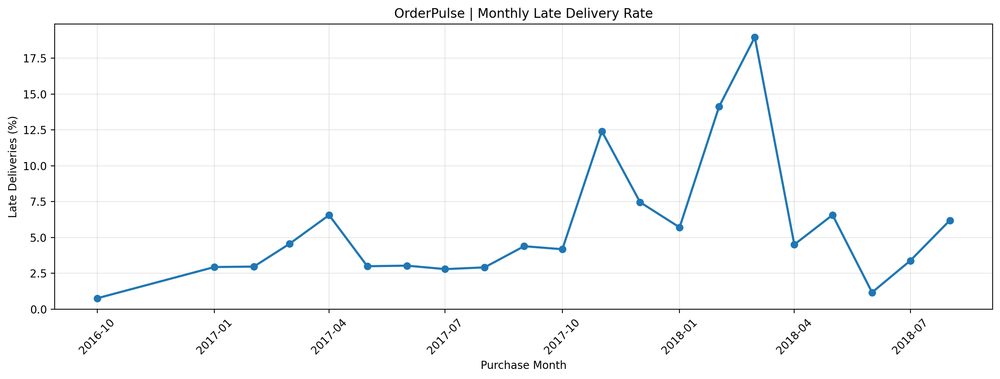
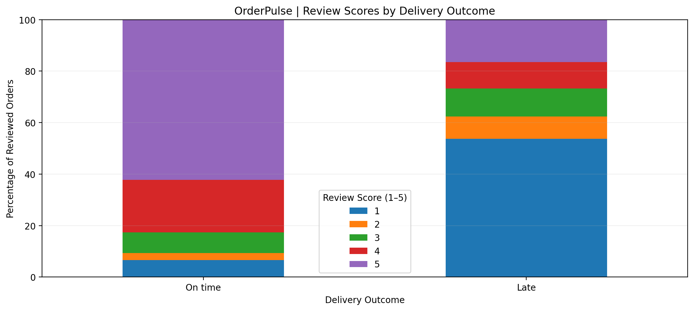
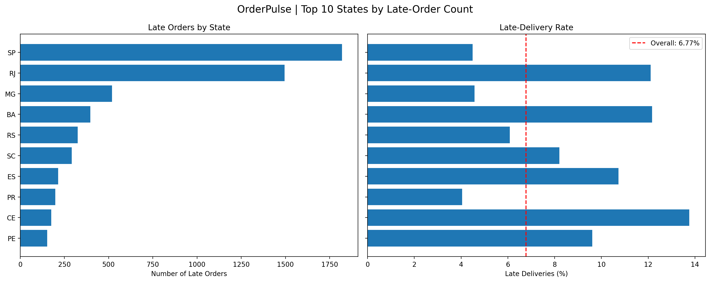
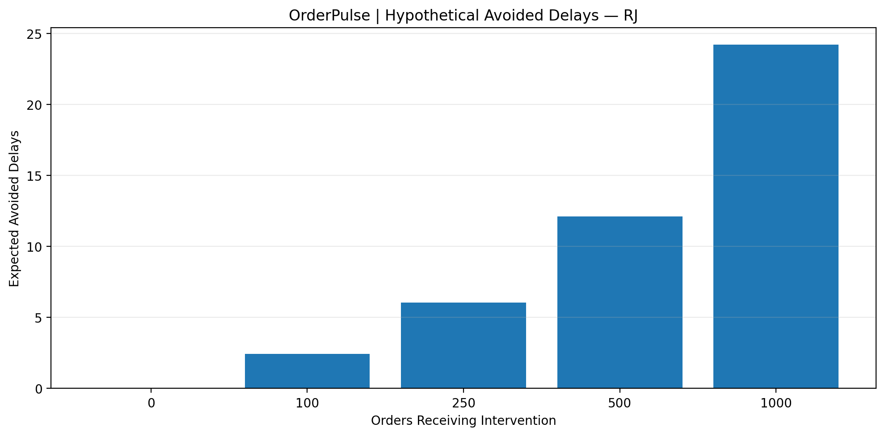

\# OrderPulse — E-commerce Delivery \& Customer Experience Analytics


An end-to-end data analytics portfolio project exploring e-commerce delivery performance, regional differences, and customer satisfaction using Python, SQL, statistical analysis, and Power BI.


## Project Highlights

| Metric | Result |
|---|---:|
| Orders analyzed | 99,441 |
| Eligible deliveries | 96,470 |
| Late deliveries | 6,534 |
| Overall late-delivery rate | 6.77% |
| Average review — on-time deliveries | 4.29 / 5 |
| Average review — late deliveries | 2.27 / 5 |

**Key insight:** Late deliveries were associated with substantially lower customer ratings in the analyzed data. This is an observational finding, not proof of causation.

## Visual Insights

### 1. Monthly Late-Delivery Rate
Shows how late-delivery performance changes over time.



### 2. Delivery Performance and Customer Reviews
Explores the relationship between delivery performance and customer ratings.


### 3. Delivery Performance by State
Helps identify geographic areas that may need further investigation.



### 4. What-If Scenario Analysis
Presents a scenario-based view to support operational decision-making.



\## Project Overview


OrderPulse analyzes historical Brazilian e-commerce data from the Olist dataset to understand delivery reliability and customer experience.


The project follows an analytics workflow:


\*\*Data preparation → Quality checks → Exploratory analysis → SQL validation → Business insights → Power BI dashboard\*\*


The objective is to turn transactional data into reliable performance metrics and identify areas that deserve further operational investigation.


\## Business Questions


\- How many orders and eligible deliveries were recorded?

\- What proportion of eligible deliveries were late?

\- How does delivery performance vary across states and purchase months?

\- Are customer reviews different for late and on-time deliveries?

\- Which locations should be investigated first?

\- How might hypothetical operational improvements affect delivery metrics?


\## Technology Stack


\- \*\*Python:\*\* Data processing, exploratory analysis, and quality checks

\- \*\*pandas and NumPy:\*\* Data manipulation and calculations

\- \*\*Matplotlib:\*\* Analytical visualizations

\- \*\*MySQL:\*\* Structured storage and SQL analysis

\- \*\*SQL:\*\* Aggregation, filtering, benchmarking, and KPI validation

\- \*\*Power BI Desktop:\*\* Interactive reporting and dashboard development

\- \*\*DAX:\*\* KPI measures and context-dependent calculations

\- \*\*Google Colab:\*\* Python development environment


\## Data Model


The project uses six processed analytical tables.


| Table | Purpose |

|---|---|

| `fact\_orders` | Order-level delivery, review, and performance metrics |

| `fact\_order\_items` | Product and seller information at order-item level |

| `dim\_customer` | Customer and geographic attributes |

| `dim\_product` | Product and category attributes |

| `dim\_seller` | Seller attributes |

| `dim\_date` | Calendar information for time-based analysis |


The model separates order-level information from item-level information to help prevent double-counting orders in business metrics.


\## Key Findings


\### Delivery Performance


| Metric | Result |

|---|---:|

| Total orders | 99,441 |

| Eligible deliveries | 96,470 |

| Late deliveries | 6,534 |

| Overall late-delivery rate | 6.77% |


The late-delivery rate is calculated using eligible deliveries as the denominator. Orders without sufficient information to evaluate lateness are excluded from this calculation.


\### Monthly Trends


\- November 2017 was the busiest purchase month, with 7,544 orders.

\- March 2018 had a qualifying monthly late-delivery rate of 18.96%, with 1,328 late deliveries among 7,003 eligible deliveries.

\- Monthly rate comparisons use a minimum-volume threshold to avoid overemphasizing small samples.


\### Regional Performance


| State | Eligible deliveries | Late deliveries | Late rate |

|---|---:|---:|---:|

| Rio de Janeiro (RJ) | 12,350 | 1,495 | 12.11% |

| Bahia (BA) | 3,256 | 396 | 12.16% |

| Ceará (CE) | 1,279 | 176 | 13.76% |


São Paulo had the largest absolute late-order volume in the analysis, with 1,820 late deliveries, but its late-delivery rate was 4.49%.


This demonstrates why operational analysis should consider both counts and rates.


\### Customer Satisfaction


A low review is defined as a score of 1 or 2 stars.


| Delivery status | Average review score | Low-review rate |

|---|---:|---:|

| On-time | 4.29 / 5 | 9.27% |

| Late | 2.27 / 5 | 62.42% |


Late deliveries were strongly associated with lower customer ratings in the historical data.


This is an observational finding; it does not prove that delivery delays alone caused lower ratings.


\## Data Quality and Validation


Data preparation included checks for:


\- Row counts and exact duplicate records

\- Missing values and delivery-date exceptions

\- Orphaned order references

\- Payment versus item-plus-freight reconciliation

\- Consistent KPI definitions and denominators


The main SQL metrics were checked against the earlier Python analysis to validate the consistency of the results.


Statistical checks also included confidence intervals, state- and month-level comparisons, buyer-cluster bootstrap analysis, and review-selection sensitivity analysis.


\## Business Recommendations


The analysis identifies locations for further investigation rather than assigning fault.


Potential next steps for an operations team include:


1\. Investigate delivery routes and processing delays in higher-rate states.

2\. Compare seller locations, shipment durations, and delivery patterns.

3\. Monitor late-delivery rates alongside absolute late-order volumes.

4\. Review customer feedback to identify additional factors associated with low satisfaction.

5\. Evaluate operational improvement ideas through measured pilots before claiming an impact.


A hypothetical what-if simulator was also developed to explore how assumed treatment capacity, effectiveness, and costs could change delivery KPIs. Its outputs are scenarios, not measured intervention results.


\## Repository Structure


```text

OrderPulse\_Outputs/

├── data/

│   └── processed/

├── docs/

│   └── METRICS.md

├── powerbi/

│   └── measures.dax

├── reports/

│   ├── action\_plan.md

│   ├── page11\_findings.md

│   ├── page12\_findings.md

│   ├── figures/

│   ├── tables/

│   ├── qa.json

│   └── source\_manifest.json

├── scripts/

│   └── load\_mysql.py

├── sql/

│   └── 01\_analysis.sql

├── .gitignore

└── README.md

```


\## Project Status


\*\*Completed:\*\* Python data preparation, core exploratory analysis, data-quality checks, statistical validation, business investigation tables, scenario simulation, MySQL loading, and core SQL analysis.


\*\*In progress:\*\* Final validation and polishing of the first Power BI dashboard page, followed by the planned Delivery Operations, Customer Experience, Product and Seller Analysis, and Action Plan pages.


\## Data Availability


The source dataset and processed CSV files are not included in this repository by default. This keeps the public repository lightweight and avoids unnecessary data redistribution.


Obtain the data from an authorized source and follow its applicable terms before reproducing the analysis.


\## Author


Built as a data analytics portfolio project demonstrating Python, SQL, data preparation, statistical reasoning, KPI development, and Power BI reporting.

